<!--
  The stats, top-languages and snake images are generated by
  .github/workflows/update-profile.yml into the profile/ folder, so they keep
  working even when public stats servers are down. Run that workflow once
  (Actions tab > Update profile cards > Run workflow) or those images stay broken.
  The streak card, badges and tech icons are still loaded from public services.
-->

<h1 align="center">Hi there 👋, I'm Muhammad Zarirul Islam</h1>

  <b>Data Scientist &nbsp;|&nbsp; Ex-Data Annotator &nbsp;|&nbsp; ClickFunnels Expert &nbsp;|&nbsp; Full Stack Web Developer</b>

  
  

---

### About me

I am a goal-oriented Computer Science graduate focused on Data Science and Machine Learning. I completed my B.Sc. at Daffodil International University with a CGPA of 3.80, and I am now pursuing a Master's in Computer Science, majoring in Data Science.

- 🌱 Currently learning: Data Science, Python, Machine Learning and Web Technologies
- 🎯 Goal: a career as a Data Scientist or ML Engineer
- 👯 Open to collaborating on GitHub
- 📫 Reach me at [zarir7116@gmail.com](mailto:zarir7116@gmail.com)

### Experience and research

- 🔬 **Thesis:** *Machine Learning Methods for Predicting Chronic Kidney Disease*, using real-world healthcare data to predict disease progression with ML models
- 🏷️ **Data Annotator (contractual), Quantigo AI**
- 🚌 **Bus Ticket Management System**, an academic project built with C and Python
- 👥 **Daffodil Computer and Programming Club:** Associate and Executive member, managing outreach through social media

### Skills

  

  
  
  
  

<!-- More icons: https://skillicons.dev — add names to the i= list, e.g. java,mysql,js -->

---

### GitHub stats

  <picture>
    <source media="(prefers-color-scheme: dark)" srcset="./profile/stats-dark.svg" />
    
  </picture>
  &nbsp;
  <picture>
    <source media="(prefers-color-scheme: dark)" srcset="./profile/top-langs-dark.svg" />
    
  </picture>

  <picture>
    <source media="(prefers-color-scheme: dark)" srcset="https://streak-stats.demolab.com?user=ZarirulIslam&theme=dark&hide_border=true" />
    
  </picture>

### Contribution activity

  <picture>
    <source media="(prefers-color-scheme: dark)" srcset="./profile/snake-dark.svg" />
    
  </picture>

---

  Stats refresh automatically once a day.

